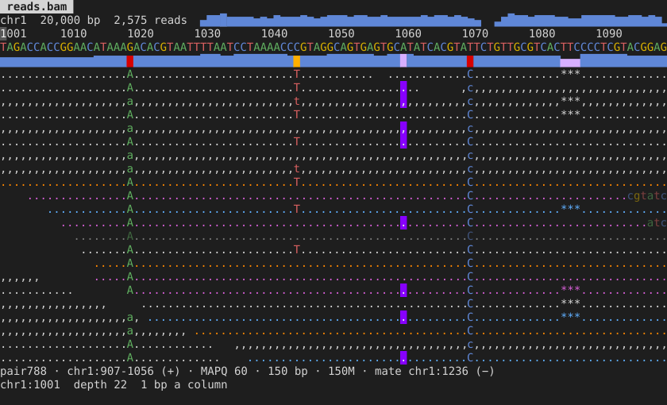
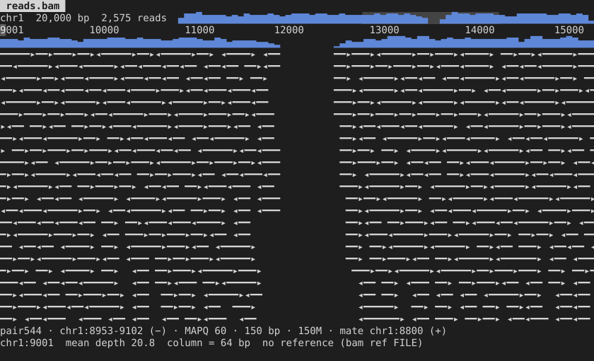
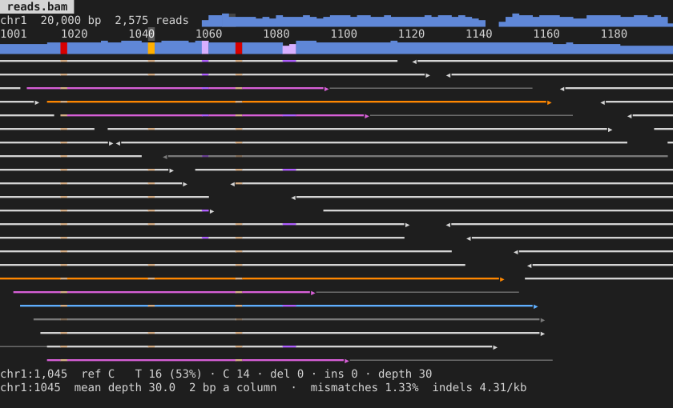

<h1>
  <picture>
    <source media="(prefers-color-scheme: dark)" srcset="docs/logo/seqpeeq-dark.svg">
    
  </picture>
</h1>

**seqpeeq** is a lightweight, terminal-based viewer of the following file types:
- **multiple sequence alignments** (aligned FASTA)
- **phylogenetic trees** (Newick)
- **mapped reads** (sorted BAM)

It's for getting things done, not making figures

#### Cool features: 
- Easily open and process large files (see [Benchmarks](#benchmarks))
- Extract regions of an MSA
- Extract or prune clades of a phylogeny
- Edit and delete bases, rows, columns, and seq names of an MSA
- Sort an MSA's rows by identity to the consensus
- Link a phylogeny to its MSA to jointly edit both and extract sequences associated with selected tips
- Select and export regions of a BAM file in fasta, fastq, and BAM formats
- Follow multi-mapped and split reads everywhere they align in a BAM
- Jump to the next covered or 0-coverage region in a BAM
- See SNPs, indels and their frequencies in a BAM while zoomed out

**Input files are never modified.** Every result is written to a new file and files can't be overwritten.

**Every change is logged.** Each command is written to a session log, which can be re-run with `seqpeeq replay`.

## Installation

### Conda environment

To build seqpeeq into its own conda environment:

```sh
conda create -n seqpeeq -c conda-forge rust
conda activate seqpeeq
git clone https://github.com/TheDBStern/seqpeeq && cd seqpeeq
cargo install --path crates/seqpeeq --root "$CONDA_PREFIX"
```


- The build downloads its libraries from crates.io.
- If cargo says ``linker `cc` not found``, load or install gcc first.

### With Rust

If you have a Rust toolchain already:

```sh
cargo install --git https://github.com/TheDBStern/seqpeeq seqpeeq
```

### Prebuilt

The GitHub releases have:

- `seqpeeq-<version>-x86_64-unknown-linux-musl.tar.gz`, a static Linux program that runs on any x86_64 Linux
- `seqpeeq-<version>-aarch64-apple-darwin.tar.gz`, for Apple-silicon Macs.

Download, check and unpack one in a terminal:

```sh
v=v0.5.0
t=aarch64-apple-darwin           # on Linux use t=x86_64-unknown-linux-musl
f=seqpeeq-$v-$t.tar.gz
curl -fLO https://github.com/TheDBStern/seqpeeq/releases/download/$v/$f
curl -fLO https://github.com/TheDBStern/seqpeeq/releases/download/$v/$f.sha256
shasum -a 256 -c $f.sha256       # on Linux use sha256sum -c $f.sha256
tar xzf $f
```

Then move `seqpeeq-$v-$t/seqpeeq` to a folder on your `PATH`, such as `~/.local/bin`.

**On a Mac, download with `curl` as above, not with a browser.** 
Fetching with `curl`, building with `cargo` or
installing with conda should work fine. If you did use a browser, you can run this to make it runnable:

```sh
xattr -d com.apple.quarantine seqpeeq
```

## Quick start

```sh
seqpeeq examples/aln.fa     # open an alignment (also: a tree, a BAM, or several at once)
```

1. Move with the arrows or `hjkl`.
2. Press `V` to select whole rows and `j` to extend the selection down a row.
3. Press `d` to delete the selected rows.
4. Press `w` to save the whole alignment to a new file. Type its name at the prompt and press Enter.
5. Press `q` to quit.

You can select reads, bases, or clades by clicking and dragging. Right-click, or press Space, on sequence names, column numbers or tree tips to pick several that aren't next to each other. Fast-move by holding Shift. Left-right scroll in BAMs or MSAs by hovering over the reference coordinates and scrolling up or down with the mouse wheel / trackpad.

Session logs are saved in the current folder as `seqpeeq-YYYYMMDD-HHMMSS.log`. To rerun a session without the interface:

```sh
seqpeeq replay seqpeeq-<log-number>.log
```

Other ways to run it:

- `seqpeeq examples/reads.bam --ref examples/ref.fa` opens a BAM with its reference.
- `seqpeeq run 'open examples/aln.fa' 'msa delete-cols --cols 1-100' 'msa extract --out trimmed.fa'` runs commands
  with no interface (see [Commands](docs/commands.md)).
- In the interface, `?` shows the keys for the tab in view, and `:` takes any [command](docs/commands.md).

## Examples

In the [`examples/`](examples) directory there are some small example files to try out the features. See the
[examples/README.md](examples/README.md) document. Run these from the top of the repository.

**An MSA and a linked tree.** Deleting a clade in the tree with `d` deletes its
sequences too.

```sh
seqpeeq examples/aln.fa examples/tree.nwk
```


**Reads against a reference.** Type `g chr1:1001` and zoom in (`+`) to see SNPs, an insertion ( purple),
deletions (`***`), split reads ( magenta), mates on another contig ( orange) and
pairs too far apart ( blue). Put the cursor on a magenta read and press
`a` to see everywhere it aligns. `}` jumps to the stretch with no reads.

```sh
seqpeeq examples/reads.bam --ref examples/ref.fa
```





**Zoomed out.** With a reference (or MD tags), each column of the coverage row is colored
according to the highest-frequency non-reference variant in it:

| Color | Description |
|---|---|
|  yellow | SNP in 15–35% of reads |
|  amber | SNP in 35–65% of reads |
|  orange | SNP in 65–90% of reads |
|  red | SNP in 90% or more |
|  light purple | insertion or deletion in 15–65% of reads |
|  purple | insertion or deletion in 65% or more |

Read ticks show mismatches against the reference:  one mismatch,  2–4,
 5 or more,  an insertion or deletion.

See [Keys](docs/keys.md) for how variants are counted.



**Two BAMs stacked.** Opening a second BAM with the same contigs stacks it under the first.

```sh
seqpeeq examples/reads.bam examples/reads2.bam --ref examples/ref.fa
```


**Without the interface.** Each argument to `seqpeeq run` is one command. The first changes the dot in every name to an
underscore (`Alpha_2019.2` becomes `Alpha_2019_2`). The second cuts the block of gaps out of the alignment:

```sh
seqpeeq run 'open examples/aln.fa' "msa rename --regex '\.' --replace '_'" 'msa extract --out renamed.fa'
seqpeeq run 'open examples/aln.fa' 'msa delete-cols --cols 611-622' 'msa extract --out trimmed.fa'
```

## Reference

- [Keys](docs/keys.md): shortcut key descriptions and read visualization info.
- [Commands](docs/commands.md): commands, logs and replay.

In the interface, `?` and `:COMMAND -h` bring up the help menus.

## Limits

- **Alignments:** FASTA, plain or gzipped. Unaligned FASTA (rows of different lengths) opens too.
- **Trees:** Newick only.
- **BAMs:** coordinate-sorted BAMs only. A missing index is built when the file is opened. CRAM is not read.

## Benchmarks

See [docs/benchmarks.md](docs/benchmarks.md) for how seqpeeq compares with other terminal viewers (termal, alv,
samtools tview and ASCIIGenome) and with IGV, FigTree and Jalview on files of different size.
For example, on an Apple M2 laptop:

- **A 30,000 × 30,000 alignment (900 MB):** seqpeeq opens it in 0.13 s; termal takes 71 s.
- **A 100,000 × 30,000 alignment (3 GB):** seqpeeq opens it in about 0.7 s once the file is in memory (0.6 to
  0.7 s across runs), or about 5.1 s from disk; Jalview takes 6.0 minutes and 12.7 GB.
- **A tree of a million tips:** seqpeeq draws it in 0.43 s; FigTree takes 27 s.

Times are for files already in memory unless they say otherwise; the benchmarks page also gives seqpeeq's times
from disk.

## Changes

See [CHANGELOG.md](CHANGELOG.md).

## License

seqpeeq is licensed under either of

- the Apache License, Version 2.0 ([LICENSE-APACHE](LICENSE-APACHE)), or
- the MIT license ([LICENSE-MIT](LICENSE-MIT)),

at your option.

Unless you explicitly state otherwise, any contribution intentionally submitted for inclusion in seqpeeq by you, as
defined in the Apache-2.0 license, shall be dual licensed as above, without any additional terms or conditions.

## AI Usage Disclosure
The majority of this codebase was generated or refactored using **Claude**. All AI-assisted code has been reviewed, tested, and verified by the project maintainers, who take full responsibility for the final implementation.
