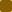

# Keys

`?` pulls up the help menu for the open file type

## Alignment

```
Move      arrows hjkl   Shift+arrows jumps
          PgUp PgDn   Home End   g go to
          / search names   n N next, previous
Select    drag   right-click extends   v V C   Esc clear
          Space, right-click a name or number  pick
Edit      d delete/gap   f fill   e extract   r rename
          many: msa rename --regex RE --replace TEXT
          i insert (shifts)   R type over   Esc stop
Zoom      - out   + in   z view whole alignment
          u U undo redo   w save the whole alignment
          c cycle colors  [ ] adjust name width  s sort
          msa delete-rows  delete-cols  fill  overwrite
          msa insert  remove  extract  rename  sort
```
`c` cycles through three color modes:

- **shade the majority base** (the default)
- **color each base** by its letter
- **no color**

`s` sorts the rows by identity to the consensus (`msa sort --by identity`). On an alignment
linked to a tree, it reorders the clades and the rows match the tree.

## Tree

```
Tree      jk rows  h parent  l back  Enter open/close
          + - z zoom  b lengths  / n N find  v select
          Space, right-click  pick several clades
          d prune  r rename  o re-root on branch
          O re-root at the midpoint
          many: tree rename --regex RE --replace TEXT
          w save the whole tree   e extract the clade
          s ladderize  u U undo redo
          a select the tips' sequences in the MSA
          p link to an open MSA
          tree extract  prune  reroot  ladderize  rename
          tree link  unlink
```

**Linking:** a tree is linked to an alignment when all the tip names match the MSA names. This happens on its
own when you open the second file, or with `p` or `:tree link`. A tip matches a sequence of the same name, or one
whose ID is the tip's name: the ID is the name up to the first space or tab, so tip `seqA` matches
`>seqA Homo sapiens COI`. A sequence of the same whole name comes first. Once linked:

- the alignment's rows follow the tree's order
- pruning a clade in the tree also deletes its sequences
- renaming a tip or a sequence renames it in both
- sorting the alignment (`s`) reorders the tree's clades to match

`:tree unlink` undoes the link; the rows keep their order.

## BAM

```
Move      arrows hjkl   Shift+arrows a screen
          PgUp PgDn   Home End   g go to, Tab a contig
BAM       ] [ covered   } { no coverage   c list contigs
          m mate   s other split part   ' back
          - + z zoom  F toggle filtered  S toggle clips
          click, drag, Space select   Esc clear
          Tab next BAM in a stack   :bam stack  unstack
          drag the coordinates, v v  select a region
          click the coverage  allele counts there
          e export reads   E export reference
          a visualize, A list all alignments for a read
          in those: S search the BAM   g go   / filter
          bam ref export-region export-reads export-ref
```

`g` takes a position on this contig, a contig's name, `contig:pos` or `contig:start-end`. If a contig has ':' in its name, put it in braces like: `{HLA:01}:100`. Tab-completion works when selecting a contig name.

**Read markings and colors:**

| Mark | Description |
|---|---|
| `.` `,` | a base that matches the reference, on the forward or reverse strand |
| `A` `c` … | a mismatch relative to the reference; upper case forward, lower case reverse, colored A  green, C  blue, G  yellow, T  red |
| `*` | a deletion |
| `─` | a skipped stretch |
|  purple cell | insertion just before this position |
| faint lower case | soft-clipped bases, colored by base (hide with `S`) |
| `━━━▸` `◂━━━` | a zoomed-out read |
| gray `─━━━▸─` | a zoomed-out read's soft-clipped ends (hide with `S`) |

Reads are colored as follows:

-  **magenta:** split, with part aligned elsewhere;
-  **orange:** mate is on another contig;
-  **blue:** paired but not a proper pair;
- **no color:** none of these.

A **dimmed** read has mapping quality 0, or is secondary, a duplicate or QC-failed. Dimmed reads don't count towards
coverage. The  blue bars along the top show coverage, and selected reads have a  gray
background.

**Where the reads differ from the reference.** With a reference attached (`bam ref FILE`) or MD tags in the reads,
each column of the coverage row is colored according to the highest-frequency non-reference variant in it:

| Coverage color | Share of the reads at that position |
|---|---|
|  yellow | 15–35% carry a SNP |
|  amber | 35–65% carry a SNP |
|  orange | 65–90% carry a SNP |
|  red | 90% or more carry a SNP |
|  light purple | 15–65% carry an insertion or deletion |
|  purple | 65% or more carry an insertion or deletion |

A position counts only when at least 3 reads and 15% of them carry the same change, which keeps random sequencing
errors from coloring the row. Each alternative base is counted on its own.

Zoomed out, each read's bar is ticked where that read differs from the reference:

| Tick | Meaning |
|---|---|
|  tan | one mismatch in that cell |
|  darker tan | 2–4 mismatches |
|  brown | 5 or more mismatches |
|  purple | an insertion or deletion |

The status line gives the mismatch rate and the insertions and deletions per kb over the reads in view.

**Click the coverage row** to see the allele counts at that column's highest-frequency variant (or at the cursor's base,
a base a column), e.g. `chr1:1,045  ref C   T 16 (53%) · C 14 · del 0 · ins 0 · depth 30`. `h` and `l` move it
along; a click anywhere else, a move up or down the reads, or Esc ends it.

**Up to three BAMs can be stacked at once** if their headers share the same contig names.

- `:bam ref FILE` attaches the reference to every BAM in the stack.
- `:bam unstack` splits the stack back into tabs, and `:bam stack FILE` stacks the current BAM with another open one.

## Every file type

```
View      Tab next file   L log   ? help   q quit
Commands  :open close use undo redo   :CMD -h details
          :rescue FILE if the log has failed
          Tab completes a file name after :tree link
Mouse     wheel over the coordinates scrolls left-right
          hold Shift (Option on macOS) to select text
          with the terminal itself
          in tmux: set -g mouse on
```
